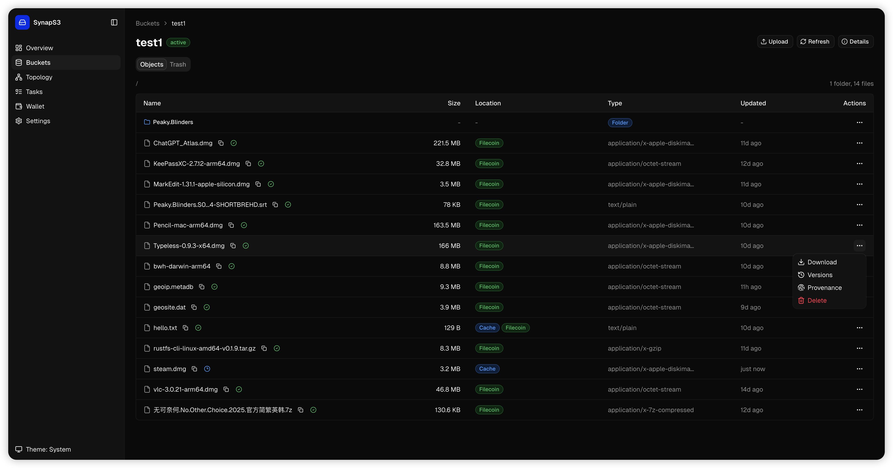
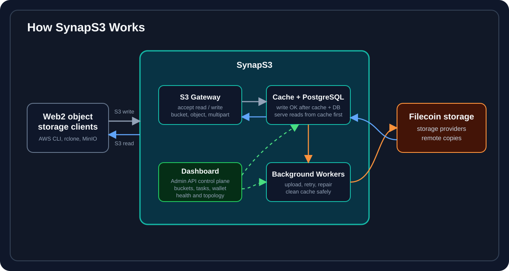

# SynapS3

SynapS3 is an open-source, self-hosted S3-compatible gateway for Filecoin storage.

## Documentation

- [Documentation](https://synaps3.strahe.com/en/)
- [中文文档](https://synaps3.strahe.com/zh/)

## Highlights

- S3-compatible bucket, object, versioning, and multipart APIs.
- Cache-first reads and writes, with Filecoin upload handled in the background.
- Dashboard, Admin API, and CLI for buckets, objects, wallet, tasks, storage providers, settings, and health.
- Single-node deployment with Docker Compose or a source build.

Coming soon: replica repair for storage provider outages.

## Dashboard

## Architecture

A write returns success after the object is stored in the local cache and its metadata is committed. Reads use the local cache first, then a committed Filecoin replica.

## Core S3 Compatibility

Clients must use path-style addressing. Objects must be 127 to 1,065,353,216 bytes.

| Area | Operation | Status | Notes |
| --- | --- | --- | --- |
| Bucket | `CreateBucket` | ✅ | |
| Bucket | `HeadBucket` | ✅ | |
| Bucket | `ListBuckets` | ✅ | |
| Bucket | `DeleteBucket` | ❌ | Returns `501 NotImplemented`. |
| Bucket | `GetBucketVersioning` | ✅ | Buckets are always versioning-enabled. |
| Bucket | `PutBucketVersioning` | ⚠️ | Accepts `Enabled`; rejects `Suspended`. |
| Bucket ACL | `GetBucketAcl` | ✅ | |
| Bucket ACL | `PutBucketAcl` | ✅ | Grants are enforced; see [Access Control](https://synaps3.strahe.com/en/reference/s3-compatibility.html#access-control). |
| Object ACL | `GetObjectAcl`, `PutObjectAcl` | ❌ | |
| Bucket policy | `GetBucketPolicy`, `PutBucketPolicy`, `DeleteBucketPolicy` | ❌ | Policies are not stored or enforced. |
| Bucket tagging | `GetBucketTagging`, `PutBucketTagging`, `DeleteBucketTagging` | ❌ | |
| Object tagging | `GetObjectTagging`, `PutObjectTagging`, `DeleteObjectTagging` | ❌ | |
| Ownership controls | `GetBucketOwnershipControls` | ⚠️ | Reports `BucketOwnerPreferred`. |
| Ownership controls | `PutBucketOwnershipControls` | ⚠️ | Accepts only `BucketOwnerPreferred`. |
| Ownership controls | `DeleteBucketOwnershipControls` | ⚠️ | The bucket keeps `BucketOwnerPreferred`. |
| Object | `PutObject` | ✅ | |
| Object | `GetObject` | ✅ | Supports a single byte range. A range read of an object that is not cached downloads the whole object from the storage provider. |
| Object | `HeadObject` | ✅ | Returns custom metadata of the requested version. |
| Object | `DeleteObject` | ✅ | See [Versioning and Deletion](https://synaps3.strahe.com/en/reference/s3-compatibility.html#versioning-and-deletion). |
| Object | `DeleteObjects` | ✅ | 1 to 1,000 keys. Reports failures per key; `Quiet=true` omits successful keys. |
| Object | `CopyObject` | ✅ | The source must be in the cache or have a committed replica. |
| Object | `ListObjects` | ✅ | Marker pagination. |
| Object | `ListObjectsV2` | ✅ | Continuation-token pagination. |
| Object | `ListObjectVersions` | ✅ | Lists versions and delete markers. |
| Object | `GetObjectAttributes` | ⚠️ | Returns `ObjectParts` for multipart objects without `TotalPartsCount`. |
| Multipart | `CreateMultipartUpload` | ✅ | |
| Multipart | `UploadPart` | ✅ | |
| Multipart | `UploadPartCopy` | ⚠️ | Whole-object copy only; a source range returns `NotImplemented`. |
| Multipart | `CompleteMultipartUpload` | ✅ | |
| Multipart | `AbortMultipartUpload` | ✅ | |
| Multipart | `ListMultipartUploads` | ✅ | |
| Multipart | `ListParts` | ✅ | |

Server-side encryption is not supported; requests with customer-provided keys (SSE-C) return `501 NotImplemented`.

Details are in the [S3 Compatibility reference](https://synaps3.strahe.com/en/reference/s3-compatibility.html). Per-operation and client results are in the [S3 Compatibility workflow runs on main](https://github.com/strahe/SynapS3/actions/workflows/s3-compatibility.yml?query=branch%3Amain).

## License

See [LICENSE](LICENSE).
